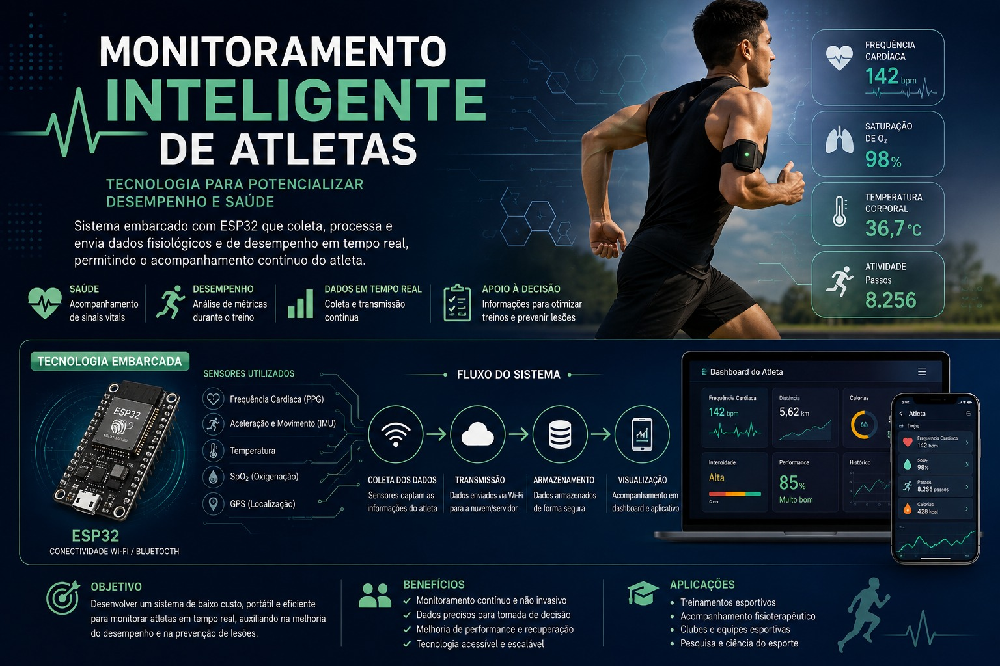
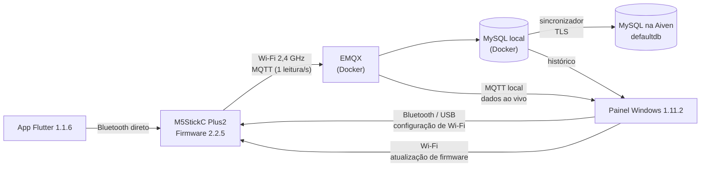

<div align="center">



# ATLETA

**Monitoramento de atividade física com M5StickC Plus2, MQTT, EMQX, MySQL local, sincronização com a Aiven, painel Windows e aplicativo Flutter.**

Projeto Integrador 6

[](https://Babi-Portella.github.io/atleta/)


[Site do projeto](https://Babi-Portella.github.io/atleta/) ·
[App Flutter](aplicativo/README.md) ·
[Firmware do M5](laboratorio/docs/FIRMWARE_M5.md) ·
[Nuvem (Aiven)](laboratorio/docs/NUVEM.md) ·
[Diagrama](docs/DIAGRAMA.md) ·
[Circuito](docs/CIRCUITO.md)

</div>

---

## Sumário

1. [Visão geral](#visão-geral)
2. [Funcionalidades](#funcionalidades)
3. [Arquitetura](#arquitetura)
4. [Componentes e versões](#componentes-e-versões)
5. [Primeiros passos no Windows](#primeiros-passos-no-windows)
6. [Painel Windows](#painel-windows)
7. [Integração com a nuvem (Aiven)](#integração-com-a-nuvem-aiven)
8. [Aplicativo Flutter](#aplicativo-flutter)
9. [Firmware do M5](#firmware-do-m5)
10. [Estrutura do repositório](#estrutura-do-repositório)
11. [Desenvolvimento com Python](#desenvolvimento-com-python)
12. [GitHub Pages](#github-pages)
13. [Backup e empacotamento](#backup-e-empacotamento)
14. [Segurança e privacidade](#segurança-e-privacidade)
15. [Validação experimental](#validação-experimental)
16. [Entregáveis da primeira N1](#entregáveis-da-primeira-n1)
17. [Limitações conhecidas](#limitações-conhecidas)
18. [Roadmap](#roadmap)
19. [Equipe](#equipe)
20. [Licença](#licença)

---

## Visão geral

O **Atleta** é uma plataforma de ponta a ponta para monitorar a atividade de uma
pessoa a partir de um dispositivo vestível. Um **M5StickC Plus2** envia uma leitura
por segundo por **MQTT** a um broker **EMQX**, que grava o histórico em um **MySQL**
local. Um **painel para Windows** inicia a infraestrutura, mostra os dados ao vivo e
sincroniza as leituras com um MySQL na **Aiven**. O **aplicativo Flutter** oferece
perfis locais, treinos e conexão direta ao relógio por Bluetooth.

O projeto cobre toda a cadeia: firmware embarcado, mensageria, persistência local e
em nuvem, aplicação desktop, aplicativo móvel e site de apresentação no GitHub Pages.

## Funcionalidades

- **Firmware 2.2.5** para M5StickC Plus2 com contagem de passos, tempo e bateria, enviando uma leitura por segundo.
- **Atualização do relógio por Wi-Fi** pelo painel, a partir do firmware 2.2.0.
- **Configuração de Wi-Fi por Bluetooth** (firmware 2.2.2 ou posterior), com opção de USB para placas com firmware anterior.
- **Transporte MQTT** sobre Wi-Fi de 2,4 GHz, com broker **EMQX** e **MySQL** em containers Docker.
- **Painel Windows 1.11.2** (`ABRIR PAINEL.exe`), com Python embutido.
- **Dados ao vivo e histórico**: os cartões mantêm os últimos valores recebidos durante interrupções.
- **Sincronização com a Aiven** por TLS, com cursor transacional e sem duplicação de amostras.
- **Aplicativo Flutter 1.1.6** com perfis locais, treinos e Bluetooth direto ao M5.
- **Credenciais e banco gerados por instalação**, sem segredos no repositório.
- **Empacotador** que gera backups verificados.
- **GitPage** com Home, Plataforma, Dispositivos e Aplicativo.

## Arquitetura



O diagrama completo da primeira versão está em
[`site/assets/diagrama-projeto-v1.svg`](site/assets/diagrama-projeto-v1.svg)
([PNG](site/assets/diagrama-projeto-v1.png)); a fonte está em
[`docs/DIAGRAMA.md`](docs/DIAGRAMA.md).

### Fluxo de dados

| Etapa | Componente | Responsabilidade |
| --- | --- | --- |
| 1 | M5StickC Plus2 | Coleta de movimento, contagem de passos, tempo e bateria |
| 2 | MQTT | Transporte de uma leitura por segundo pela rede Wi-Fi |
| 3 | EMQX | Recebimento e distribuição das mensagens |
| 4 | MySQL local | Armazenamento do histórico |
| 5 | Sincronizador | Cópia incremental das leituras para a Aiven |
| 6 | Painel Windows | Exibição ao vivo, histórico, configuração e atualização do M5 |

### Circuito

O esquema resume os componentes internos do M5 utilizados no projeto. Consulte o
[SVG](site/assets/circuito-v1.svg), o [PNG](site/assets/circuito-v1.png) e a
[pinagem](docs/CIRCUITO.md).

## Componentes e versões

| Componente | Versão | Local |
| --- | --- | --- |
| Painel Windows | 1.11.2 | `laboratorio/painel/` |
| Firmware do M5 | 2.2.5 | `laboratorio/firmware/` |
| Aplicativo Flutter (código-fonte) | 1.1.6 | `aplicativo/` |
| APK de teste | 1.1.8 (assinado) | `aplicativo/entrega/` |
| Flutter | 3.44.3 | requisito para compilar o app |
| Python (desenvolvimento) | 3.12 | requisito para rodar o painel pelo código |

> O código da versão 1.1.8 do aplicativo não estava disponível no projeto de origem.
> O código-fonte incluído corresponde à 1.1.6.

## Primeiros passos no Windows

**Requisitos:** Windows x64, Docker Desktop em modo *Linux containers* e internet no
primeiro uso (o Docker baixa as imagens de MySQL e EMQX).

1. Extraia **todo** o ZIP em uma pasta local (não execute de dentro do ZIP).
2. Inicie o Docker Desktop.
3. Abra **`ABRIR PAINEL.exe`**. O executável já inclui o Python.
4. Clique em **Preparar computador** e siga a indicação do painel para iniciar o laboratório.
5. Configure o Wi-Fi do M5 (veja [Painel Windows](#painel-windows)) e aguarde **M5 conectado**.

Se o Windows bloquear o EXE pelo Controle de Aplicativo, instale as dependências
conforme [Desenvolvimento com Python](#desenvolvimento-com-python) e abra
**`ABRIR PAINEL PYTHON.cmd`**.

### Histórico e migração

O backup contém **8.904 registros** do MySQL local (8.898 do M5 e 6 de teste), até
23/11/2026 às 20:22:50, horário de Fortaleza. A pasta `laboratorio/migracao/` guarda
o snapshot que o painel restaura ao iniciar o laboratório em uma instalação nova.
O perfil do painel acompanha o pacote. O perfil e os treinos salvos pelo app Android
permanecem no celular em que foram gravados.

## Painel Windows

A aba **Início** mostra passos, tempo e bateria ao vivo pelo MQTT local, além do
estado do servidor, do M5 e da nuvem.

### Conectar o relógio

1. **Preparar computador** inicia o servidor. Se ele já estiver pronto, siga em frente.
2. **Configurar Wi-Fi** envia a rede e a senha ao M5 por Bluetooth (firmware 2.2.2 ou posterior).
   - Libere **Wi-Fi por Bluetooth** com o botão **B** no relógio.
   - O painel preenche a rede ativa do notebook e a senha, quando o Windows libera a chave.
   - Após **Enviar por Bluetooth**, a busca aguarda até um minuto enquanto você libera o relógio, e pode ser cancelada antes do envio.
   - **Usar hotspot do notebook** seleciona o Hotspot móvel de 2,4 GHz e envia ao M5 o endereço do servidor nessa rede.
   - O M5 testa a rede antes de gravá-la e começa uma nova sessão ao reiniciar.
3. **Ver dados do atleta** abre passos, bateria e histórico. Depois de configurar, basta ligar o M5 na mesma rede; o cabo USB pode ser retirado.

A rede de 2,4 GHz precisa permitir que o relógio alcance o computador servidor.

### Outras ações

- **Atualizar por Wi-Fi** abre a janela de atualização do firmware do relógio. Detalhes em [FIRMWARE_M5.md](laboratorio/docs/FIRMWARE_M5.md#atualização-por-wi-fi-pelo-painel).
- **Configurar por USB** fica na janela de configuração, para placas com firmware anterior.
- **Opções avançadas** reúnem IP, portas, Dashboard e parada do servidor.
- O **perfil do atleta** fica em uma aba opcional.
- **Ver detalhes** abre o registro de operações e falhas do servidor.

### Comportamento dos dados

- Abrir uma tela ou detectar o USB **não** altera a configuração da placa.
- **M5 conectado** exige uma leitura real recente.
- Após 10 segundos sem dados, a tela mostra **Sem dados recentes — últimos valores recebidos**, com data e firmware da leitura. Os valores voltam a atualizar sozinhos quando o M5 reconecta.
- A opção **Manter última leitura** vem marcada; desmarque-a para ocultar valores desatualizados.
- O histórico permanece na tabela. Um registro salvo não comprova a conexão atual.
- Uma falha da nuvem aparece separadamente do recebimento local dos dados.

## Integração com a nuvem (Aiven)

O painel inicia a sincronização automaticamente quando `laboratorio/cloud.local.json`
está habilitado. A linha **Nuvem conectada** informa quantas leituras estão pendentes.

**Como ativar:** o pacote já traz host, porta, banco `defaultdb`, usuário de
sincronização e certificado CA, com a sincronização **desativada**. Abra
`laboratorio/cloud.local.json`, preencha a senha da conta de sincronização e mude
`"enabled"` para `true`. O painel aberto envia o histórico e as novas leituras.

**Garantias de entrega:**

- Conexão por **TLS**, com validação do certificado e do nome do servidor.
- Lotes enviados do **mais antigo para o mais recente**.
- O cursor é salvo **na mesma transação** do lote na nuvem.
- A identidade da amostra impede **duplicação** na retomada.
- O banco local é acessado por conta **somente leitura**; a nuvem usa conta restrita.

**Operação:** o computador e o painel precisam permanecer ligados. Fechar o painel
pausa a cópia; EMQX e MySQL continuam ligados, e as leituras pendentes são
recuperadas ao reabrir.

Para acompanhar o `defaultdb` pelo terminal, depois de configurar a Aiven, abra
**`ABRIR LEITURA AIVEN.cmd`** (Ctrl+C encerra). Veja
[configuração, recuperação e limites](laboratorio/docs/NUVEM.md).

## Aplicativo Flutter

O [app do ATLETA](aplicativo/README.md) oferece perfis locais, treinos e conexão
direta por Bluetooth ao M5. O projeto inclui assets, testes e configurações para
Android, iOS e web.

```powershell
cd aplicativo
flutter pub get
flutter build apk --release
```

Requer **Flutter 3.44.3**. Em `aplicativo/entrega/` estão o APK 1.1.6 (do código
incluído) e o APK de teste 1.1.8, já assinado. Uma nova build em outro computador
pode ser assinada com outra chave de desenvolvimento.

## Firmware do M5

Código em PlatformIO e C++ em `laboratorio/firmware/`; os binários atuais ficam em
`laboratorio/entrega/`. Para compilar, na raiz do projeto, no PowerShell:

```powershell
py -3.12 -m venv .venv-lab
.\.venv-lab\Scripts\python.exe -m pip install -r laboratorio\requirements.txt
.\.venv-lab\Scripts\python.exe laboratorio\tools\release.py --firmware-only
```

Para gravar por USB, substitua `COM3` pela porta do relógio:

```powershell
.\.venv-lab\Scripts\python.exe laboratorio\tools\flash.py --port COM3
```

Depois do firmware 2.2.0, as atualizações podem ser feitas por Wi-Fi pelo painel.
Mais detalhes em [FIRMWARE_M5.md](laboratorio/docs/FIRMWARE_M5.md) e
[laboratorio/README.md](laboratorio/README.md).

## Estrutura do repositório

```text
atleta/
├── ABRIR PAINEL.exe            # Painel Windows (inclui Python)
├── ABRIR PAINEL PYTHON.cmd     # Painel pelo código-fonte
├── ABRIR LEITURA AIVEN.cmd     # Leitura do defaultdb no terminal
├── LEIA PRIMEIRO.txt           # Resumo rápido de uso
├── aplicativo/                 # Projeto Flutter, testes e entrega (APKs)
├── laboratorio/
│   ├── painel/                 #   Código Python do painel
│   ├── firmware/               #   PlatformIO e C++ do M5
│   ├── emqx/  sql/             #   Regras do broker e esquema do banco
│   ├── migracao/               #   Snapshot restaurado ao iniciar
│   ├── entrega/                #   Binários atuais
│   ├── docs/                   #   NUVEM.md, FIRMWARE_M5.md etc.
│   ├── evidencias/             #   Resultados de validação
│   └── tools/                  #   release.py, flash.py
├── site/                       # GitPage, banner, diagramas e downloads
├── docs/                       # Diagramas e relatórios em PDF
├── tools/                      # Geradores e empacotador (empacotar.py)
├── codigo-original/            # API HTTP anterior, preservada como referência
└── .github/                    # Publicação automática da GitPage
```

Configurações particulares (`laboratorio/config.local.json`, `laboratorio/cloud.local.json`
e `laboratorio/runtime/`) são locais e ficam fora do backup compartilhável.
Veja o [guia de organização](docs/ORGANIZACAO.md).

## Desenvolvimento com Python

Necessário apenas para desenvolvimento, para abrir o painel pelo fonte ou para ler a
Aiven pelo terminal. Com **Python 3.12**, na raiz do projeto:

```powershell
py -3.12 -m venv .venv-lab
.\.venv-lab\Scripts\python.exe -m pip install -r laboratorio\requirements.txt
```

Depois use `ABRIR PAINEL PYTHON.cmd` ou `ABRIR LEITURA AIVEN.cmd`.

## GitHub Pages

O workflow [`.github/workflows/pages.yml`](.github/workflows/pages.yml) publica
somente a pasta `site/`. Em **Settings → Pages**, selecione **GitHub Actions**.

> EMQX, o MySQL local e o painel executam no PC servidor. O sincronizador copia as
> leituras para a Aiven. A GitPage apresenta o projeto e **não** consulta o banco.

Prévia local:

```powershell
python -m http.server 8765 --bind 127.0.0.1 --directory site
```

Depois, acesse `http://127.0.0.1:8765`.

## Backup e empacotamento

Com Python instalado, na raiz do projeto:

```powershell
python tools/empacotar.py
```

- O ZIP completo, o checksum e o manifesto são salvos em `../Backups/Atleta/`.
- O processo verifica binários, sintaxe Python, links locais e ZIPs.
- Use `--output` para escolher um destino fora do projeto.
- Os dois ZIPs em `site/downloads/` são downloads da GitPage e são regenerados pelo empacotador.

## Segurança e privacidade

- Cada instalação nova cria suas **próprias credenciais e banco de dados**; as novas configurações são enviadas ao M5 pelo mesmo fluxo de configuração.
- Senhas, chaves privadas e credenciais administrativas ficam na instalação de origem, **fora do código, do Git e dos pacotes públicos**.
- A senha de Wi-Fi é definida ao configurar o M5.
- A nuvem usa TLS com validação de certificado e nome do servidor, e uma conta restrita de sincronização.
- O banco local é acessado por uma conta somente de leitura.
- O ZIP compartilhável não inclui caches nem dados pessoais.
- O perfil do painel acompanha o pacote de migração; confira o conteúdo antes de compartilhá-lo.

## Validação experimental

Ensaio de **02/10/2026** com o firmware 2.1.7:

| Medição | Resultado |
| --- | --- |
| Amostras enviadas por MQTT/MySQL na captura | **12.113** |
| Caminhada de 20 passos curtos | **17 passos** registrados |
| Colocar e manusear o relógio | Nenhum passo adicional contado |

É uma **medição pontual**, feita com uma versão anterior do firmware, sem garantia de
precisão geral. Dados em
[`laboratorio/evidencias/contador-passos-2.1.7.json`](laboratorio/evidencias/contador-passos-2.1.7.json).

## Entregáveis da primeira N1

| Requisito | Arquivo |
| --- | --- |
| GitPage: Home, Plataforma, Dispositivos e Aplicativo | [site/index.html](site/index.html) |
| Firmware 2.1.7 conectado à plataforma própria | [main.cpp](laboratorio/firmware/src/main.cpp), [activity.h](laboratorio/firmware/src/activity.h), [guia](laboratorio/README.md) |
| Diagrama completo | [SVG](site/assets/diagrama-projeto-v1.svg), [PNG](site/assets/diagrama-projeto-v1.png), [fonte](docs/DIAGRAMA.md) |
| Banner atualizado | [PNG](site/assets/banner-atleta-v1.png) |
| Circuito eletrônico | [SVG](site/assets/circuito-v1.svg), [PNG](site/assets/circuito-v1.png), [pinagem](docs/CIRCUITO.md) |
| Aplicativo da primeira versão | [Painel Windows](laboratorio/entrega/PainelIP.exe) e [código](laboratorio/painel/app.py) |

## Limitações conhecidas

- Distância e calorias são **estimativas** que dependem do perfil.
- BPM, SpO₂, temperatura corporal e GPS ilustrados no banner são **expansões futuras**.
- O código original FastAPI está preservado em `codigo-original/`; sua integração à telemetria é futura.
- A sincronização com a Aiven só funciona com o computador e o painel ligados.
- O código-fonte do APK 1.1.8 não estava disponível; o código incluído é o da 1.1.6.
- O perfil e os treinos do app Android permanecem no celular de origem.
- O primeiro uso exige internet para o Docker baixar as imagens.
- Docker Desktop com containers Linux é obrigatório.

## Roadmap

- [ ] Integrar a API original (FastAPI) à telemetria
- [ ] Medição de frequência cardíaca (BPM) e SpO₂
- [ ] Medição de temperatura corporal
- [ ] Localização por GPS
- [ ] Recuperar o código-fonte do APK 1.1.8 e alinhar com o repositório
- [ ] Ampliar a validação do contador de passos com o firmware 2.2.5

## Equipe

| Integrante | GitHub |
| --- | --- |
| Babi Portella | [@Babi-Portella](https://github.com/Babi-Portella) |
| Emilio467 | [@Emilio467](https://github.com/Emilio467) |
| jvBaracho | [@jvBaracho](https://github.com/jvBaracho) |

As contribuições individuais serão registradas quando confirmadas; a hospedagem
na conta da Babi não atribui a ela autoria exclusiva do projeto.

## Licença

A licença do projeto ainda **não foi definida**. Até que um arquivo `LICENSE` seja
adicionado, todos os direitos permanecem reservados à equipe.
